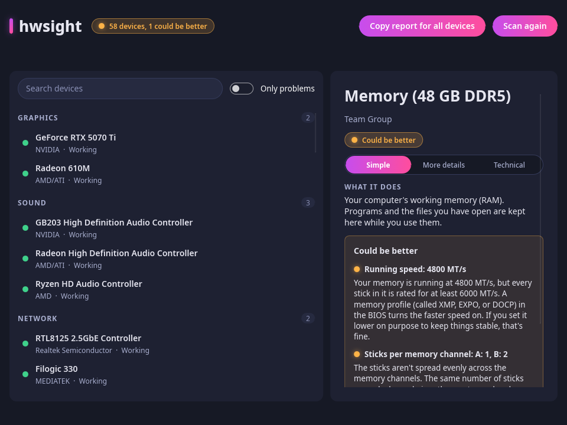
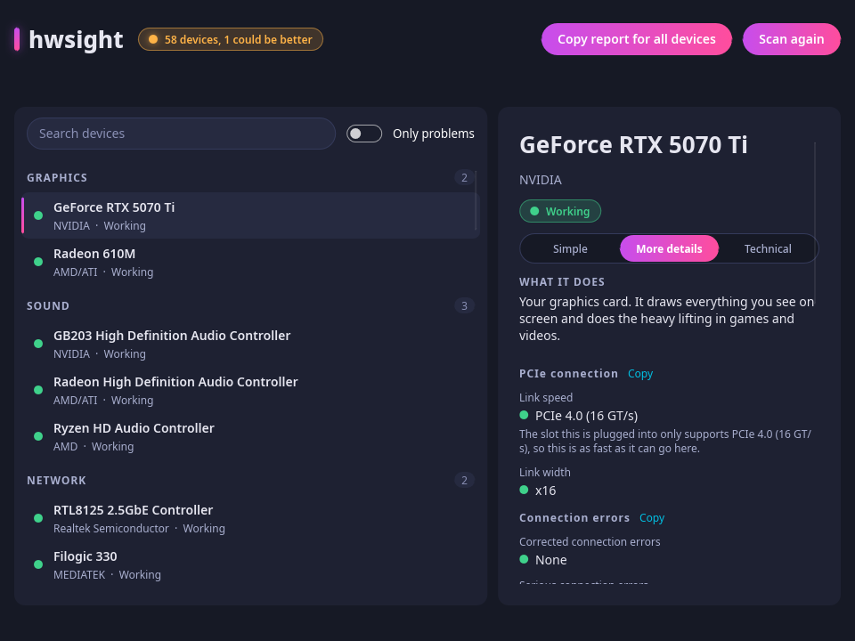
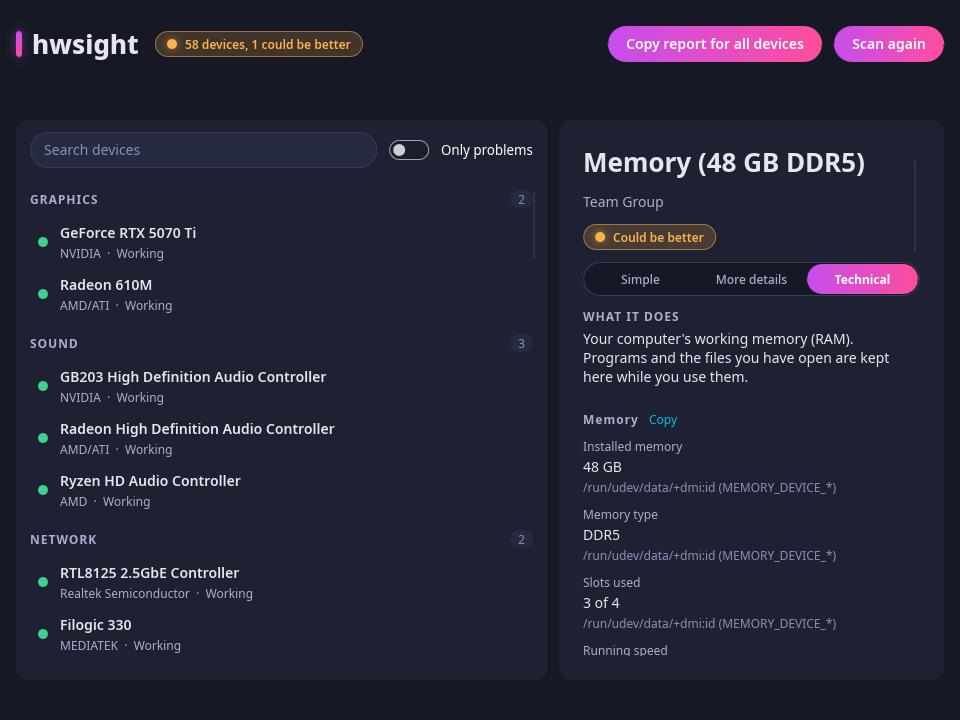

# hwsight

**The Device Manager Linux has been missing.**

Your computer is full of hardware, and most of the time you can't tell whether all of it is
doing its job. hwsight looks at everything inside and plugged into your PC, tells you in plain
English what's healthy and what isn't, and then goes further: it finds the problems you didn't
know you had, explains why they happen, and shows you the fix for *your* distro.

> **Status: first release coming shortly.** There are no packages yet, but you can build it
> from source today (see below). Watch or star the repo to be there when it lands.

## See it

**Plain English, with the fix.** hwsight spotted that this PC's RAM is running well below
the speed it was sold for, and says what to do about it:



**Key numbers with a verdict.** The graphics card's link speed, width, and Resizable BAR
state, each judged for you:



**Every detail, with its source.** The Technical level shows what was read and exactly where
it came from:



## Why hwsight

**It answers the question you actually have.** Not "what's the vendor ID of this chip?" but
"is my stuff working, and if not, what do I do?" Every device gets a clear status, and every
problem comes with what's wrong, why it matters, and the steps to fix it, with the exact
package and command for Arch, Debian, Ubuntu, Fedora, or openSUSE.

**It finds problems you'd never think to look for.** Most hardware trouble isn't a red error,
it's quietly lost performance. hwsight catches:

- RAM running at 4800 MT/s when every stick is rated for 6000, and sticks spread unevenly
  across channels
- a graphics card stuck in a slow PCIe slot, or with Resizable BAR switched off
- a fast USB drive plugged into a USB 2 port
- a Wi-Fi 7 adapter held back to Wi-Fi 6 by the router, with a weak signal or the slow band
- a cable that negotiated 100 Mb/s on a gigabit adapter
- drives that are failing, running hot, or have firmware updates waiting
- firmware update lists that went stale, and drivers that are installed but never loaded

**It reads the kernel log so you don't have to.** When a driver fails, hwsight finds the real
reason, such as the exact firmware file the driver is waiting for, and maps it to the package
that provides it on your distro.

**It's for beginners and for experts, at the same time.** One click switches between *Simple*
(plain English), *More details* (the key numbers, each with a verdict), and *Technical*
(everything it can read, with the exact file and raw value behind each one). Nothing is
hidden from people who want it, and nothing is dumped on people who don't.

**It shows its work.** In Technical view every value says where it came from, so you can
check it yourself, and you can copy any group of details or a whole report for a forum post
with your user name and computer name already removed.

**It gets you through a firmware update safely.** It finds updates for drives, receivers, and
more, installs them one device at a time after you confirm, and treats BIOS updates with
the care they deserve: it tells you one exists and how to get it, but never installs it for you.

**It asks before it changes anything.** hwsight reads by default. Anything that needs admin
rights goes through your desktop's own password window, and it says so up front. It never
sees your password and never reads serial numbers, MAC addresses, or Wi-Fi network names.

**It stays current without waiting for a release.** Device names, rules, firmware packages,
and translations live in signed data files that update on their own, so support for new
hardware and new distros arrives as data, not as a new app.

**It works everywhere.** Every major distro, read-only systems like Fedora Atomic, Bazzite,
and SteamOS (it won't suggest things that can't work there), 12 languages, a modern window
that looks the part, and a full command-line mode for scripts and servers.

**It's free and open source,** GPL-3.0-or-later, with no accounts and no telemetry. The only
network use is the optional check for updates, and it works fine offline.

## The full feature list

- **Lists every device**, grouped by type: graphics, network, sound, storage, USB, Bluetooth,
  displays, memory, processor, motherboard, and more.
- **Gives each one a status**, and tells apart the cases that matter: a driver is installed
  but not running, a driver is turned off by a setting, a driver failed to start, firmware is
  missing, or nothing on the computer supports the device.
- **Explains problems using the kernel log**, for example which firmware file a driver is
  waiting for, and shows the fix with the right package and install command for your distro.
- **Three levels of detail.** *Simple* is plain English. *More details* adds the key facts
  with a verdict (good, could be better, problem). *Technical* shows everything it can read,
  with the exact file each value came from.
- **Reads a lot, without needing a password**, including:
  - PCIe link speed and width against what the slot allows, and whether Resizable BAR is on
  - memory: sticks, rated speeds (XMP and EXPO) against the speed you're running
  - processor, caches, and security mitigations; drives and their health; monitors
    (refresh rate, VRR, HDR); USB connection speed
  - network: wired link speed, Wi-Fi signal, band, and Wi-Fi generation
  - temperatures, fan speeds, and power from the kernel's sensors; NVIDIA readings through
    the driver's own tool
  - Secure Boot and TPM state; the audio chip; firmware versions
- **Finds firmware updates** through fwupd and lets you install them one device at a time,
  with a confirmation first. **BIOS and other system firmware are never installed by
  hwsight.** It tells you an update exists, shows the command, and warns you to keep the
  computer plugged in, since a failed BIOS update can leave a computer unable to start.
- **Suggests software worth having** for a device, such as a Logitech receiver manager or an
  RGB controller, in plain words.
- **Offers to install tools that unlock more information**, when the computer has the
  hardware they help with. It always says that your password is needed, and the system asks
  for it in its own window. hwsight never sees it.
- **Copies a report for a forum post**, for one device, one group of details, or the whole
  computer. Your user name and computer name are removed.
- **Speaks your language:** English, German, Spanish, French, Italian, Japanese, Korean,
  Dutch, Brazilian Portuguese, Russian, Turkish, and Simplified Chinese. Reports are always
  in English so the people answering forum posts can read them.
- **Has a command line too:** `hwsight` for the list, `hwsight --problems` for only what
  needs attention, `hwsight --details <address>` for everything about one device, and
  `hwsight --json` for scripts and bug reports.

## Safe by design

- It reads. It doesn't change your system unless you press a button and confirm.
- Anything that needs administrator rights goes through your desktop's normal password
  window (polkit). hwsight never asks for or stores your password.
- It never reads serial numbers, MAC addresses, or Wi-Fi network names, and the copied
  reports remove your user name and computer name.
- Its knowledge (device names, rules, firmware packages, translations) lives in data files
  that can be updated without a new release. Updates are signed and checked before use.

## Works on any distro

Built for the major Linux distributions: Arch, Debian, Ubuntu, Fedora, and openSUSE and
their relatives. Advice and install commands adapt to your distro, and read-only systems
(Fedora Atomic, Bazzite, SteamOS) are recognised so hwsight doesn't suggest things that
can't work there. Packages are planned as .deb, .rpm, and AppImage, plus an AUR package.

## Build from source

You need a recent stable [Rust](https://www.rust-lang.org/) toolchain.

```sh
git clone https://github.com/sweatshopking/hwsight
cd hwsight
cargo run --release -p hwsight-gui    # the window
cargo run --release -p hwsight-cli    # the command line
```

`tools/check.sh` runs every check (formatting, lints, tests, translation catalogs, and a
test that the window opens).

## What's next

Packaging and a first release, help for devices that have no driver (suggesting the right
package for your distro), more per-device explanations, and more translations review.

## Built with

[Rust](https://www.rust-lang.org/) and [Slint](https://slint.dev/).

## Licence

[GPL-3.0-or-later](LICENSE)
